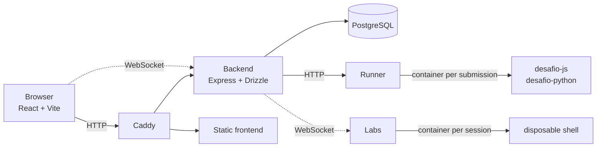
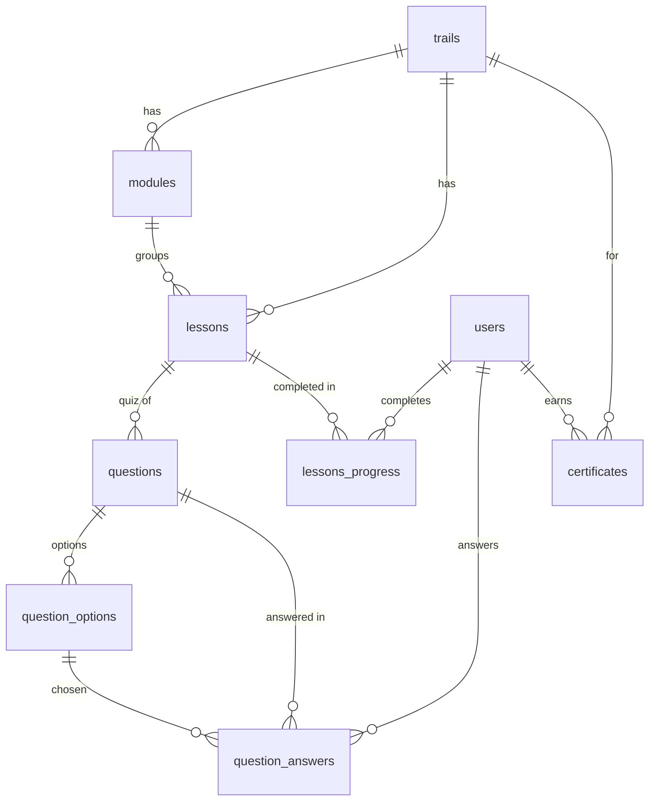
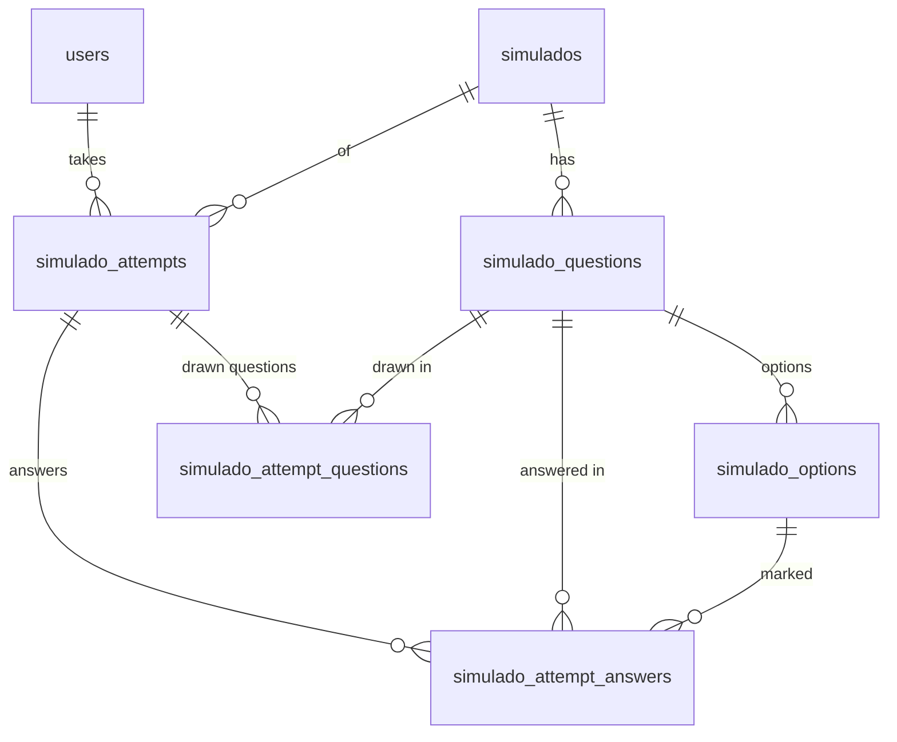
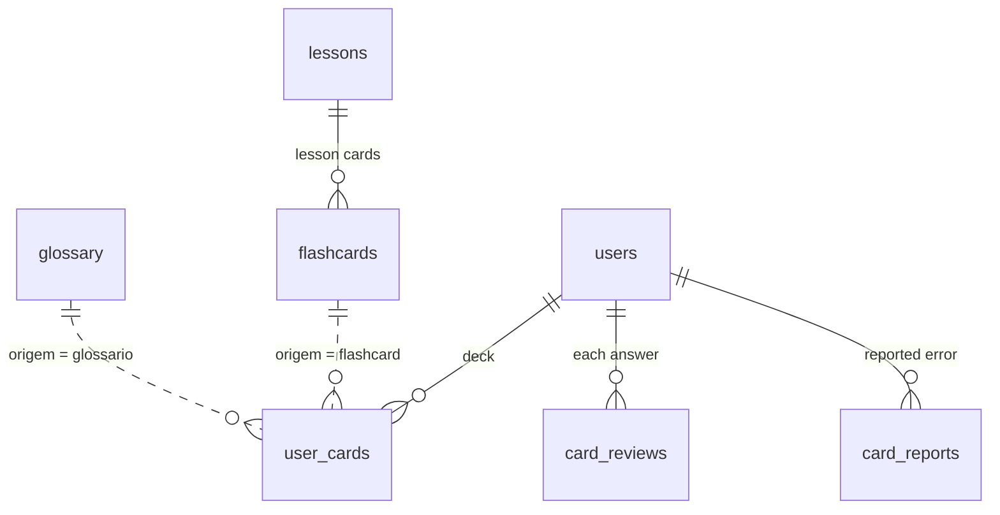

# ensina.dev

**English** | [Português](README.pt-BR.md)

A programming study platform in Portuguese: lesson tracks, coding challenges graded
on the spot, certification practice exams, Linux labs with a real terminal and
spaced repetition flashcards. All content is free, and nothing is locked behind a
paywall.

Live at [ensinadev.com.br](https://ensinadev.com.br)

## What the platform does

| Area | What it is |
| --- | --- |
| **Tracks and lessons** | Block-based content (text, table, code, quote) with a quiz at the end of each lesson. Programming tracks have per-language paths, with the same lesson in JavaScript and Python. |
| **Roadmaps** | Career sequences of tracks, from the first `if` up to specialist level. |
| **Challenges** | Daily coding exercises, run and graded against a test suite. |
| **Practice exams** | Exams in the format of real certifications (AWS, Azure, ISTQB, PSPO I, among others), with domains, a per-area report, a practice mode and favorites. |
| **Review** | Flashcards scheduled along Ebbinghaus's forgetting curve. |
| **Interviews** | Technical interview questions by topic and level, from intern to senior, as cards with an answer outline. |
| **Labs** | A Linux terminal inside the lesson, in a disposable container, where `sudo` is allowed because the machine belongs to the student and is gone at the end. |
| **Resume** | Resume analysis against a job posting, with a hybrid engine: the score is deterministic and the qualitative reading comes from a language model. A supporter benefit. |
| **Community** | Posts, comments, likes and public profiles. |
| **Progress** | XP, streak, achievements, league ranking and a completion certificate with public validation. |
| **Raffles** | Prize raffles among students, with sign-up on the platform and the draw run from the Estúdio. |
| **Support** | An optional Pix subscription that helps keep the platform running, with a badge on the profile and in the ranking, an accent color, a custom background and the resume analysis. |
| **Estúdio** | Admin panel to author tracks, questions, challenges, practice exams, roadmaps, raffles and announcements. |

## Tech stack

**Backend**

- **Node 22** running TypeScript natively, with no build step. There is no `tsc` in the execution path, only for type checking.
- **Express 5** and **Zod** for input validation.
- **Drizzle ORM** on **PostgreSQL 16**, with versioned migrations in `backend/drizzle`.
- **JWT** with a refresh token in an httpOnly cookie, passwords in **Argon2** (migrating from bcrypt on login).
- **helmet**, **express-rate-limit** and account lockout after failed attempts.
- **ws** for the lab terminal, **pdfkit** and **qrcode** for the certificates, **nodemailer** for email, **unpdf** to read the uploaded resume, and **@anthropic-ai/sdk** for the resume analysis model (in production, DeepSeek's compatible endpoint).

**Frontend**

- **React 19** with **Vite** and **React Router 7**.
- **CodeMirror** in the challenge editor, **xterm.js** in the lab terminal.
- **react-markdown** with **remark-gfm**, **remark-math** and **KaTeX** for lesson content, which allows math formulas in the calculus tracks.
- Hand-written CSS with theme tokens in `frontend/src/styles/tokens.css`. No UI framework.

**Infrastructure**

- **Docker Compose** for development and production.
- **Caddy** as the reverse proxy, with automatic TLS.
- **GitHub Actions** for type checking, tests and deploy.
- **AWS Lambda** in São Paulo for the external monitor.

## Architecture

The non-obvious part is that **the backend never runs student code**. Two separate
services do that, and they are the only ones that talk to Docker.



- **Runner**: receives the code of a submission, starts an ephemeral container
  with the language image, runs the tests and returns the result. No network and
  a time limit.
- **Labs**: serves a shell over WebSocket. The backend checks who owns the session
  and issues a ticket that lasts 30 seconds and burns on first use. Details in
  [`labs/README.md`](labs/README.md).
- **Monitor**: an external monitor built to run outside the server, on AWS Lambda
  in São Paulo, and send an email when the site, the API, the database or the
  backup fails for users in Brazil. Details in [`monitor/README.md`](monitor/README.md).

This separation exists so that an isolation failure in student code cannot reach
the database or anyone's data.

## Running locally

Requirements: Docker and Docker Compose.

```bash
git clone git@github.com:jpavrdev/plataforma-estudos.git
cd plataforma-estudos

cp backend/.env.example backend/.env   # set DATABASE_URL and JWT_SECRET
docker compose up -d

# create the tables
docker compose exec backend npx drizzle-kit migrate
```

| Service | Address |
| --- | --- |
| Frontend | http://localhost:5173 |
| API | http://localhost:3001 |
| PostgreSQL | localhost:5432 |

Only `DATABASE_URL` and `JWT_SECRET` are required. Everything else is optional and
degrades gracefully: without SMTP the verification link goes to the log instead of
an email, without the certificate variables issuing is turned off, and without an
AI key the resume analysis uses only the deterministic engine. The full list is in
[`backend/src/config/env.ts`](backend/src/config/env.ts), the source of truth.

For challenges and labs to work, the execution images must exist in the daemon:

```bash
bash runner/build-images.sh
bash labs/build-images.sh
```

### Seeding content

The seeds live in `backend/scripts` and are idempotent: running them twice does not
duplicate anything.

```bash
docker compose exec backend node scripts/seed-trilha-python.ts
docker compose exec backend node scripts/seed-flashcards.ts
```

## Layout

```
backend/
  app.ts            Express, middlewares and route mounting
  index.ts          HTTP server, separate because of the WebSocket
  schema.ts         Drizzle schema, the source of truth for the database
  drizzle/          versioned migrations
  scripts/          content seeds and maintenance scripts
  src/
    routes/         route modules
    controllers/    HTTP in and out, no business rules
    services/       where the business rules live
    schemas/        Zod validation of requests
    middlewares/    authentication, rate limiting, error handling
    domain/         pure rules with no I/O (XP, streak, raffle draw, challenge grading)
  tests/            integration tests against an ephemeral Postgres

frontend/
  src/
    pages/          one folder per screen
    components/     shared components
    contexts/       authentication, theme, toast
    services/       HTTP clients per domain
    styles/         CSS per area, with theme tokens

runner/             isolated challenge executor
labs/               disposable Linux terminal
monitor/            external monitor (AWS Lambda)
deploy/             Caddyfile and production assets
```

## Data model

There are 55 tables, and almost all of them hang from one of two axes: **`users`**,
for everything that belongs to the student, and **`trails`**, for everything that is
content. Understanding these two already makes the rest readable.

| Area | Anchored on | Tables |
| --- | --- | --- |
| **Content** | `trails` | `modules`, `lessons`, `questions`, `question_options`, `tags`, `trail_tags`, `trail_reviews`, `glossary`, `languages` |
| **Account** | `users` | `oauth_accounts`, `tokens`, `user_follows` |
| **Progress** | both | `lessons_progress`, `question_answers`, `achievements`, `user_achievements`, `ranking_snapshots`, `certificates` |
| **Roadmaps** | both | `roadmaps`, `roadmap_stages`, `roadmap_stage_refs`, `roadmap_stage_completions`, `user_roadmaps` |
| **Practice exams** | `users` | `simulados`, `simulado_questions`, `simulado_options`, `simulado_attempts`, `simulado_attempt_questions`, `simulado_attempt_answers`, `simulado_favoritos` |
| **Challenges** | `users` | `challenges`, `challenge_tests`, `challenge_submissions`, `challenge_comments` |
| **Review** | both | `flashcards`, `user_cards`, `card_reviews`, `card_reports` |
| **Interviews** | standalone content | `interview_topics`, `interview_cards` |
| **Community** | `users` | `community_posts`, `community_comments`, `community_likes`, `community_comment_likes`, `community_post_tags` |
| **Raffles** | `users` | `sorteios`, `sorteio_participacoes` |
| **Operations** | `users` | `subscriptions`, `resume_analyses`, `comunicados`, `comunicado_respostas`, `feature_flags`, `feature_flag_users` |

The three areas marked "both" belong to the student but draw on content that comes
from the track. Interview questions are standalone content on purpose: what comes
up in an interview does not follow the order of any track. The diagrams below open
up the three parts where the structure is not obvious.

### Content and progress

The backbone of the product. The student reads the lesson, answers the quiz, and
both become progress.



One completion per student and lesson, one answer per student and question, and one
certificate per student and track. All three are unique constraints in the
database, not conventions.

### Practice exams

The part with the most tables, because an attempt **freezes** the questions it
drew. Without that, editing the exam later would rewrite exams already taken.



### Spaced repetition

A solid line is a real foreign key. A dashed line is a relationship that exists in
the application but **not** in the database, and the reason is right below.



`user_cards`, `card_reviews` and `card_reports` are **polymorphic**: the `origem_id`
column points to `flashcards.id` or to `glossary.id` depending on the value of
`origem`, and that is why it **has no foreign key**. Whoever looks for this
relationship in the database will not find it. The uniqueness is
`(user_id, origem, origem_id)`.

### Modeling notes

- **`lessons.trail_id` is denormalized.** The lesson already belongs to the track through its module, but the direct column avoids a join in a hot query.
- **Postgres does not index foreign keys on its own.** A new FK column needs an `index()` declared in the schema.
- **`community_comments.parent_id` points to the same table**, with single-level threads.

The diagrams above are a map, not the specification. The source of truth is
[`backend/schema.ts`](backend/schema.ts).

## Migrations

After changing `schema.ts`:

```bash
docker compose exec backend npx drizzle-kit generate   # generate the migration
docker compose exec backend npx drizzle-kit migrate    # apply it
```

Always review the generated migration before committing. Renaming an enum value,
for example, is something drizzle-kit solves by dropping and recreating the type,
which deletes data; the right way in that case is to write
`ALTER TYPE ... RENAME VALUE` by hand.

## Tests

```bash
cd backend
npm run test:unit                  # unit tests, no database
bash tests/run-integration.sh      # integration tests
```

The integration tests start an ephemeral Postgres in a container, apply the
migrations and tear everything down at the end.

> **Warning:** `npm test` in the backend root runs the whole suite against the
> `DATABASE_URL` of your environment and **truncates the tables**. For integration
> tests, always use `run-integration.sh`, which isolates the database.

## CI and deploy

`.github/workflows/pipeline.yml` runs on every push and pull request to `develop`
and `main`:

1. **backend-tests**: type checking, unit tests, migrations and integration tests.
2. **frontend-build**: type checking and production build.
3. **monitor**: type checking and tests of the external monitor and of its infrastructure.
4. **deploy**: only on pushes to `main`. It builds the images on the server over SSH, applies the migrations, runs the content seeds and corrections, restarts the services and checks the site's health.

The branch flow is `feature` → `develop` → `main`.

## Contributing

- Code is written in English: file names, functions, variables, routes, API fields and comments. What the user reads (screens, error messages, emails) stays in Portuguese. Older code is still in Portuguese.
- Commit messages and PR titles start with a conventional prefix (`feat:`, `fix:`, `chore:`, `refactor:`, `docs:`) and are written in Portuguese.
- Before opening a PR: `npm run lint` and `npm run format:check` in both projects.
- Found a security issue? Do not open a public issue. The process is in [SECURITY.md](SECURITY.md) (in Portuguese).

## License

A personal project, still without a defined license. Until then, all rights are
reserved: read it, study it and learn from it freely, but talk to me before reusing
the content or the code elsewhere.
